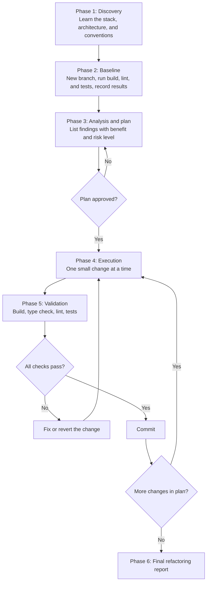
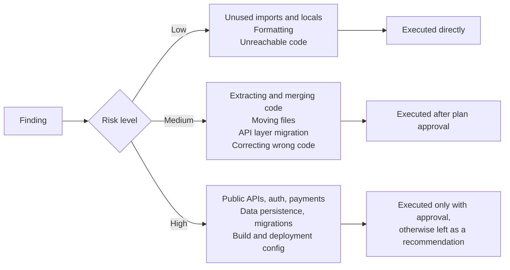
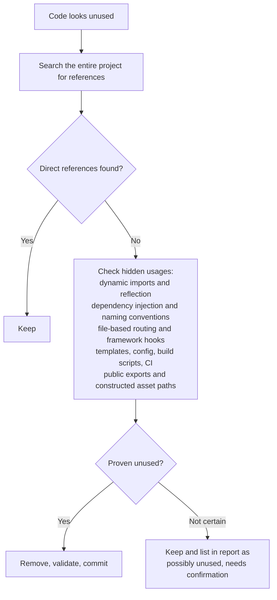
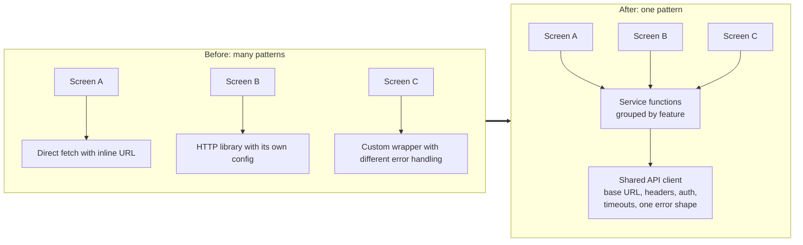
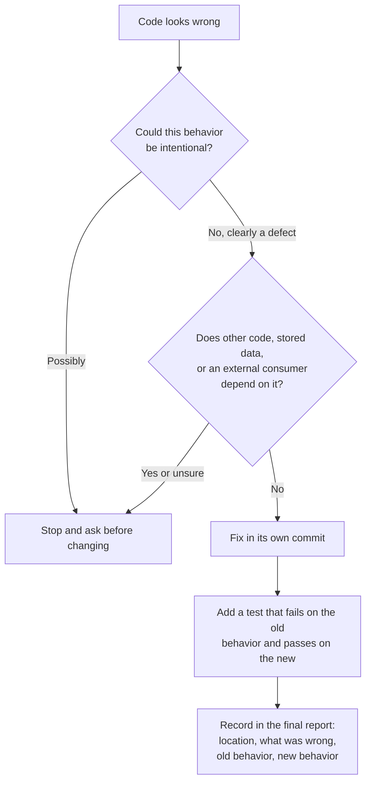

# Flutter Refactoring Agent

A production-grade AI agent for Flutter codebase refactoring, dead code removal, reusable widget extraction, UI consistency, API standardization, performance optimization, and clean, maintainable code architecture.

Give it to an AI coding tool and it behaves like a careful senior engineer: it studies the project first, records a working baseline, plans its changes by risk, applies them in small verified steps, and hands back a full report of everything it did.

## Contents

- [Why this exists](#why-this-exists)
- [What the agent does](#what-the-agent-does)
- [Flutter-specific guidance](#flutter-specific-guidance)
- [How it works](#how-it-works)
- [Safety model](#safety-model)
- [Unified API calling](#unified-api-calling)
- [Correcting wrong code](#correcting-wrong-code)
- [The final report](#the-final-report)
- [Installation](#installation)
- [Usage](#usage)
- [Customizing](#customizing)
- [FAQ](#faq)
- [Contributing](#contributing)
- [License](#license)

## Why this exists

Codebases collect clutter over time: unused files, copy-pasted logic, giant components, three different ways of calling the same API, and packages nobody remembers adding. Cleaning this up by hand is slow, and asking an AI to "refactor the project" without guardrails is risky, because it may delete code that only looks unused, rewrite things in its own preferred style, or quietly change behavior.

This agent definition solves that by giving the AI a strict process and firm limits. The core idea is simple:

> Improve how the code is written. Do not change what it is meant to do.

## What the agent does

| Area | What happens |
| --- | --- |
| Dead code removal | Removes unused files, functions, classes, imports, variables, assets, and styles, but only after proving they are unused |
| Code duplication | Merges repeated logic and parallel implementations into one shared place |
| Reusable modules | Splits large files and long functions into small, focused, well-named units |
| UI consistency | Replaces look-alike UI elements across screens with centralized components, keeping the rendered result the same |
| Unified API calling | Moves every network request onto one shared API client and one calling pattern |
| Correcting wrong code | Fixes code that is clearly written wrong, in separate commits, each with a test |
| Clean architecture | Applies SOLID, DRY, and KISS without adding needless layers |
| File and folder structure | Organizes the project in a consistent, scalable layout and updates every reference |
| Coding standards | Consistent naming, formatting, and explicit error handling that follow the project's own rules |
| Simplification | Removes overengineering, pointless wrappers, and speculative abstractions |
| Performance | Fixes real inefficiencies such as redundant work, N+1 queries, unnecessary re-renders, and leaks |
| Dependencies | Removes unused and redundant packages after checking code, config, and tooling |
| Documentation | Keeps useful comments, removes stale ones, updates docs that the changes made inaccurate |
| Validation | Runs build, type check, lint, and tests after every change set |
| Final report | Delivers a detailed account of everything removed, changed, fixed, and deferred |

## Flutter-specific guidance

The agent follows existing Flutter and Dart conventions, including state management, reusable widgets, theming, routing, localization, platform integration, and resource lifecycle management. It checks asset declarations and generated references before deletion, and uses the project's existing validation commands (such as `flutter analyze`, `flutter test`, and relevant platform builds). It preserves the existing app behavior and does not introduce new dependencies or architecture without approval.

## How it works

The agent follows six phases in order and never skips ahead.



### Phase 1: Discovery

The agent reads before it writes. It identifies the languages, frameworks, build system, test runner, linter, and formatter, maps the architecture, and notes every public surface that outside consumers depend on, such as endpoints, exported APIs, and config keys.

### Phase 2: Baseline

It creates a dedicated branch and runs the build, type checker, linter, and full test suite, recording the results, including failures that already existed. This is what lets it later tell its own breakage apart from problems that were there before. Where critical code has no tests, it writes tests that pin down current behavior before touching it.

### Phase 3: Analysis and plan

It audits the whole project and writes a plan. Every finding records the location, the problem, the proposed change, the benefit, and a risk level. The plan also includes an inventory of every API calling pattern in the project and a list of code it believes is written wrong, with reasoning.

### Phase 4: Execution

Changes are applied in order of increasing risk, one category at a time. Each logical change is checked and committed on its own, so any single step can be reviewed or reverted.

### Phase 5: Validation

After each change set, and again at the end, the agent confirms that the build succeeds, type checking and linting pass with no new warnings, and the full test suite matches the baseline. It is never allowed to weaken or delete a test to make it pass.

### Phase 6: Final report

A structured report of everything done. See [The final report](#the-final-report).

## Safety model

### Risk tiers

Every planned change gets a risk level, and the level decides how it is handled.



### Proof before deletion

Nothing is removed on the assumption that it is unused. A plain search can miss real usages, so the agent also checks the places where references hide.



### Hard rules

The agent must not:

- Change intended business rules, API contracts, data schemas, UI/UX, or user flows
- Correct wrong code silently; every correction is isolated, tested, and reported
- Leave more than one API calling pattern in the project
- Delete anything it has not proven unused
- Touch secrets, environment files, applied migrations, generated code, or vendored code
- Add new dependencies, frameworks, or tooling without approval
- Rewrite working code just because it prefers another style
- Mix unrelated changes in one commit
- Guess when it is uncertain; it stops and asks

## Unified API calling

A common source of bugs and confusion is having several ways to call APIs in one project. The agent consolidates them into a single shared layer.



How it gets there:

1. **Inventory** every network request and group them by pattern.
2. **Choose the standard** from what the project already uses. No new HTTP library is added without approval.
3. **Build one shared client** that owns the base URL, default headers, auth token handling, serialization, timeouts, and a single error shape.
4. **Expose service functions** on top of it, with endpoint definitions kept in one place. Screens and business code call these functions and never the HTTP client directly.
5. **Migrate every call site**, one feature at a time, verifying each.
6. **Delete the old helpers** so no second pattern remains, then search the project to confirm nothing bypasses the shared layer.

The requests sent over the network stay identical: same method, URL, parameters, headers, and body. Only the calling code changes. Where one call was different on purpose, such as a custom timeout, the difference is kept as an explicit option.

## Correcting wrong code

Business rules are preserved, but code that is clearly written wrong is corrected, not carefully preserved.



**Counts as wrong:** inverted or always-true conditions, off-by-one errors, wrong variable used, missing `await`, swallowed errors, null crashes, race conditions, resource leaks, incorrect status checks, security flaws, and calculations that contradict the documented rule.

**Does not count as wrong:** behavior that is unusual, or that the agent would have designed differently, but that could be deliberate. A business rule the agent disagrees with is not a bug.

## The final report

When the work is done, the agent delivers a report with these sections:

1. **Summary** with before-and-after metrics (file count, lines of code, dependencies, bundle size, lint warnings, test results)
2. **Removed** files, functions, assets, and dependencies, each with evidence it was unused
3. **Consolidated** duplicates, with old and new locations
4. **Reusable components and modules created**, and where each is used
5. **Structural changes** as an old-path to new-path mapping
6. **Performance improvements** and their effect
7. **API layer**: patterns found, standard chosen, call sites migrated, helpers removed
8. **Corrections to wrong code**: every intentional behavior change, with its test
9. **Other issues resolved** without behavior change
10. **Validation results** compared to the baseline
11. **Not changed, needs attention**: unproven dead code, unclear cases, deferred high-risk items
12. **Recommendations** in priority order

## Installation

The agent is a single markdown file: [`flutter-refactorer.md`](.claude/agents/flutter-refactorer.md).

### Claude Code

Download `flutter-refactorer.md` from this repository, then, from your project root, copy it into the project so the whole team gets it:

```bash
mkdir -p .claude/agents
cp /path/to/flutter-refactorer.md .claude/agents/
```

Or into your home directory to use it in all your projects:

```bash
mkdir -p ~/.claude/agents
cp /path/to/flutter-refactorer.md ~/.claude/agents/
```

See the [Claude Code documentation](https://docs.claude.com/en/docs/claude-code/overview) for current details on subagents.

### Other AI coding tools

Paste the file's content into your tool's rules or instructions file (many tools read `AGENTS.md` from the project root). Remove the frontmatter block at the top if your tool does not use it.

### Chat or API

Use the file's content as the system prompt.

## Usage

**Before you start:** commit or stash your work, and make sure the project builds and its tests run. The agent relies on these to verify its changes.

**Step 1: ask for a plan only.**

```
Use the flutter-refactorer agent to run Phases 1 to 3 on this project.
Show me the plan and do not change any code yet.
```

**Step 2: review and approve.** Read the findings, the API pattern inventory, and the list of suspected wrong code. Approve all of it, or only parts.

```
Approved. Execute the low- and medium-risk items.
Leave the high-risk items as recommendations.
```

**Step 3: review the result.** Read the final report, check the commits on the refactoring branch, and merge through your normal review process.

You can also limit the scope:

```
Use the flutter-refactorer agent on the src/features/billing folder only.
```

```
Use the flutter-refactorer agent to unify API calling only. Skip everything else.
```

## Customizing

The file is plain text, so edit it to fit your team:

- **Add your stack's commands** to Phase 5, for example `npm run build`, `npm run lint`, `npm test`.
- **Add protected paths** to the hard rules, for example folders the agent must never touch.
- **Tighten or loosen autonomy** by changing which risk levels need approval in Phase 3.
- **Name your conventions**, such as folder layout or the API client to standardize on, so the agent does not have to infer them.

## FAQ

**Will it break my app?**
The process is designed to prevent that: a baseline before any change, validation after every change, small revertible commits, and work on a separate branch. It is still an AI making changes, so review the plan and the final diff before merging.

**What if my project has few or no tests?**
The agent writes tests that capture current behavior for critical code before refactoring it. If the project cannot be built or tested at all, it stops and limits itself to zero-risk changes.

**Does it work with any language or framework?**
This edition is tailored to Flutter and Dart. Its general refactoring and safety principles can also be adapted to other stacks.

**Will it upgrade my packages?**
No. It removes unused packages only. Outdated or vulnerable ones are listed as recommendations.

**Can it run without supervision?**
Yes. In that mode it executes low- and medium-risk items and leaves high-risk items as recommendations.

## Contributing

Issues and pull requests are welcome. If the agent made a poor decision on your project, open an issue describing the situation; real cases are the best way to improve the rules.

## License

Released under the [MIT License](LICENSE).
